<div align="center">



# Paper

**Traitement de texte open source pour macOS, à la Apple.**

Éditeur riche complet inspiré de Microsoft Word, interface conçue selon la charte Apple (style Pages) : onglets, contrôles segmentés, accent bleu système, typographie SF.

`Swift` `AppKit` `WebKit` `Zéro dépendance` `Open source (MIT)`

[](https://www.apple.com/macos) [](../../releases) [](LICENSE) [](../../releases)

</div>

---

## Sommaire

1. [Installation](#installation)
2. [Fonctionnalités](#fonctionnalités)
3. [Formats de documents](#formats-de-documents)
4. [Raccourcis clavier](#raccourcis-clavier)
5. [Architecture](#architecture)
6. [Contribuer et versions](#contribuer-et-versions)

## Installation

**Téléchargement** : la dernière version est disponible sur la [page des releases](../../releases) sous forme de DMG, publié automatiquement à chaque version.

1. Ouvrez le DMG et faites glisser `Paper.app` dans `Applications`.
2. Au premier lancement, macOS peut signaler une application non signée par un développeur identifié : faites **clic droit → Ouvrir**.

**Compiler depuis les sources** (Xcode Command Line Tools, macOS 12+) :

```bash
git clone https://github.com/MrFlappy0/Mac-office.git
cd Mac-office
./build.sh
open Paper.app
```

Le script génère l'icône, compile, signe l'app et construit `Paper-x.y.dmg`.

## Fonctionnalités

### Interface à onglets

| Onglet | Contenu |
|---|---|
| **Accueil** | Styles de paragraphe, polices, tailles, gras/italique/souligné/barré, exposant, indice, couleurs, surlignage, recherche |
| **Insertion** | Liens, images, tableaux, caractères spéciaux, date, page de garde, ligne horizontale |
| **Mise en page** | Alignements, listes à puces et numérotées, retraits, interligne, effacer la mise en forme |
| **Affichage** | Plan du document, zoom (clavier et boutons), aide des raccourcis |

### Édition

- Page A4 avec marges de 2,5 cm, correction orthographique native
- Undo/redo illimité, compteur mots/caractères/temps de lecture
- Recherche et remplacement en carte flottante
- **Sauvegarde automatique** : un document non enregistré est proposé à la restauration au prochain lancement
- Plan de navigation : les styles Titre 1-3 alimentent un panneau latéral cliquable
- Barre contextuelle des tableaux : lignes, colonnes, en-têtes, suppression
- Collage sans mise en forme, page de garde, 56 caractères spéciaux
- Alertes de document non enregistré (fermeture et quitter)

## Formats de documents

| Format | Ouvrir | Enregistrer | Notes |
|---|---|---|---|
| **.docx** (Office Open XML) | oui | **oui, natif** | Générateur OOXML intégré : styles, titres, listes numérotées, tableaux, couleurs, liens |
| **.doc** (Word 97, HTML) | oui | oui | Compatible Word, Pages, LibreOffice |
| **.html** | oui | oui | Rendu fidèle de la page |
| **.pdf** | — | oui | Export page A4 avec marges |

L'export `.docx` est généré directement dans l'application (conteneur ZIP + Office Open XML écrits à la main, sans bibliothèque externe) : paragraphes, titres, citations, listes à puces et numérotées imbriquées, tableaux avec en-têtes, gras, italique, souligné, couleurs, surlignage, exposants, indices, interlignes, liens externes. Les images ne sont pas encore incluses dans l'export `.docx` (voir feuille de route).

## Raccourcis clavier

| Raccourci | Action |
|---|---|
| `Cmd+N` / `Cmd+O` | Nouveau / Ouvrir |
| `Cmd+S` | Enregistrer en .docx |
| `Cmd+Maj+S` | Enregistrer en Word 97 (.doc) |
| `Cmd+E` / `Cmd+P` | Exporter en PDF / Imprimer |
| `Cmd+F` | Rechercher et remplacer |
| `Cmd+B` / `Cmd+I` / `Cmd+U` | Gras / italique / souligné |
| `Cmd+Alt+Maj+V` | Coller sans mise en forme |
| `Cmd +` / `Cmd -` / `Cmd+0` | Zoom avant / arrière / 100 % |

## Architecture

```
src/main.swift     Coquille native : fenêtre, menus, fichiers, PDF, impression (AppKit + WebKit)
src/editor.html    Interface d'édition : onglets, ruban, plan, commandes JS, export .docx
src/icon.swift     Génération de l'icône de l'application (AppKit/CoreGraphics)
src/Info.plist     Métadonnées du bundle
build.sh           Compilation, icône, signature, DMG
VERSION            Numéro de version courant (pilote les releases)
.github/workflows  Publication automatique du DMG en release à chaque version
docs/demo.svg      Démo animée (SVG SMIL) affichée dans ce README
```

**Choix techniques** : zéro dépendance, pas de framework, tout est fourni par le système. Swift/AppKit pour la coquille native (menus, boîtes de dialogue, panneau d'impression), WebKit pour l'éditeur riche, et un générateur ZIP/OOXML en JavaScript pur pour l'export Word.

## Contribuer et versions

Chaque version est documentée dans [docs/AVANCEMENT.md](docs/AVANCEMENT.md) et publiée automatiquement en release avec son DMG (workflow GitHub Actions) :

1. Le code est poussé sur `main` avec le fichier `VERSION` mis à jour.
2. Actions construit l'app et le DMG sur `macOS`.
3. La release `vX.Y` est créée avec `Paper-X.Y.dmg` en pièce jointe.

**Feuille de route**

- v0.5 : images dans l'export .docx, préférences (police par défaut, marges)
- v0.6 : thème sombre, en-têtes et pieds de page, numérotation des pages
- v0.7 : ouverture .docx avancée (mise en page fidèle), styles personnalisés

---

Licence MIT — voir [LICENSE](LICENSE). Projet développé par Théo Noël.
